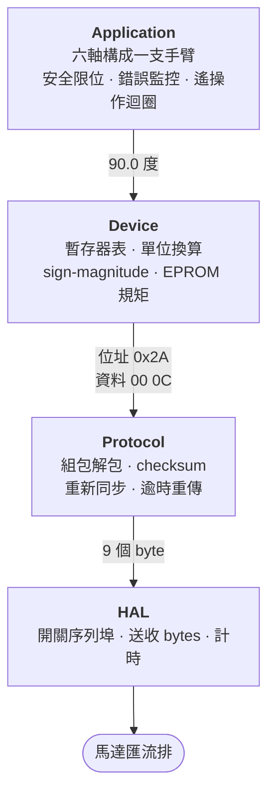

# 驅動分層架構

**狀態**：C-37
**讀者**：下學期接手這份 C 驅動的人（很可能是半年後的我自己）
**目的**：看完能判斷「這段程式碼該放哪一層」，而不只是理解分層的概念

四層界定於 W5 定案（`lab-log/week05.md`），此後一路被遵守——`make layers` 檢查的就是其中一條。但這些決定的**理由**此前只存在於當時的討論裡，沒有進 repo。這份文件補上。

分層是下學期移植成敗的關鍵，也是報告裡最值得講的設計決策，所以它需要一份獨立文件，而不是散在實驗記錄裡。

---

## 閱讀前：哪些已實作，哪些沒有

本學期主線於 W10 調整為 Python（C-25），C 驅動收在**驗收 A/B 與模擬器**（C-26）。這份文件描述的架構因此分成三種狀態，內文會逐節標示：

| 標記 | 意義 |
|---|---|
| **【已實作】** | 本學期完成並通過驗收，程式碼在 repo 裡 |
| **【已定案未實作】** | 設計已定、理由已確認，但程式碼屬下學期 |
| **【下學期重新面對】** | 本學期的做法是權宜，移植時條件會改變 |

C 驅動的停止點是「PC 端協定驗證」，不是「真機驅動」。接手前請先讀 `lab-log/week10.md` 第三節的收尾範圍表。

---

## 1. 一個動作走完四層

分層在做什麼，用一個實際動作講最清楚：應用層要「把肩膀轉到 90 度」。

### 往下走　【已實作】

這條路徑本學期已完成並通過驗收 B（驅動組包 vs 手冊）。

| 層 | 收到 | 做的事 | 交給下一層 |
|---|---|---|---|
| Application | `90.0`（度） | 檢查 90 度在此關節允許範圍內、跟目前位置差多少、是否超過單步幅度限制 | `90.0`（度） |
| Device | `90.0`（度） | 4096 階對應 360°，中位 2048 為 0° → `2048 + 1024 = 3072` 步；sign-magnitude 編碼（正數不變）；拆兩個 byte，低位在前 | 位址 `0x2A`，資料 `00 0C` |
| Protocol | 位址 + 資料 | 組封包、算 Length、算 checksum | 9 個 byte |
| HAL | 9 個 byte | 真的送到線上 | — |

Protocol 層組出來的封包：

```
FF FF 01 05 03 2A 00 0C C0
└─┬─┘ │  │  │  │  └─┬─┘ │
 字頭 ID │  │ 位址  資料 checksum
         │  └ Instruction (WRITE)
         └ Length

Length   = 參數 3 個 + 2 = 5
checksum = ~(01+05+03+2A+00+0C) & 0xFF = ~0x3F & 0xFF = 0xC0
```

注意「90 度」這個概念在 Device 層之後就消失了，「位址 `0x2A`」在 Protocol 層之後也消失了。每跨一層，一種語言換成另一種。

### 往上走　【已定案未實作】

解析路徑依賴收包狀態機，屬下學期（C-26）。設計已定，記在這裡供接手時參照。

馬達回 `FF FF 01 02 00 FC` 六個 byte。

| 層 | 做的事 | 往上送 |
|---|---|---|
| HAL | 把 bytes 交上去，不知道意義 | 6 個 byte |
| Protocol | 找字頭、合理性檢查、驗 checksum | `COMM_SUCCESS` + `error = 0x00`（兩個獨立的值） |
| Device | 看通訊結果；馬達狀態原樣往上，不作解釋 | 同上 |
| Application | 檢查 error byte 的位元，決定是否停止 | — |

---

## 2. 四層的界定　【已實作】

判斷一層寫對了沒有，看它「不知道什麼」比看它「知道什麼」更準。

### HAL — 硬體抽象層

**知道**：序列埠名稱、鮑率、怎麼開關埠、怎麼計時。

**不知道**：`0xFF 0xFF` 是什麼意思、checksum 是什麼、匯流排上有幾顆馬達。對它來說上面丟下來的就是一串無意義的 bytes。

介面的定案版本是函式表加 `ctx`，見 `include/sts_hal.h` 與 C-14（`lab-log/week09a.md`）。

### Protocol — 協定層

**知道**：字頭、Length 算法、checksum、Status Packet 怎麼拆、收到雜訊怎麼重新同步、逾時要重傳幾次。

**不知道**：`0x2A` 這個位址代表什麼。位址對它只是一個數字。也不知道那顆馬達是肩膀還是夾爪。

### Device — 裝置層

**知道**：暫存器表、單位換算（1 步 = 0.088°、50 步/秒 ≈ 0.732 RPM、電流 1 單位 = 6.5 mA）、sign-magnitude 的方向位在哪一位、EPROM 寫入前要關扭力並把 Lock 寫 0。

**不知道**：ID=1 那顆裝在哪個關節、使用者想讓手臂做什麼、有沒有安全限位的需求。

### Application — 應用層

**知道**：六顆馬達組成一支手臂、哪個 ID 是哪個關節、每個關節的軟體限位、什麼情況該緊急停止、遙操作迴圈的時序。

**不知道**：封包長什麼樣、哪個暫存器在哪個位址、序列埠怎麼開。

### 資料流



---

## 3. 層與層之間的三條規則　【已實作】

### 規則一　呼叫是單向的

上層呼叫下層，下層完全不知道上層存在。Protocol 層裡沒有一行提到「手臂」，HAL 層裡沒有一行提到「封包」。

實際好處：**可以在下面塞假的實作來測上面**。模擬器就是靠這條成立的——它是另一組 HAL 實作，上面三層完全不知道自己在跟誰講話。本學期 872 項測試全部在沒有真機的情況下跑完，這條規則是前提。

### 規則二　每個邊界都是一次翻譯

| 邊界 | 上面的語言 | 下面的語言 |
|---|---|---|
| Application → Device | 度 | — |
| Device → Protocol | — | 位址 + 資料 bytes |
| Protocol → HAL | — | 一串 bytes |

判斷標準：**一層不該同時處理兩種語言**。安全層的程式碼裡如果出現 `0x2A` 這種裸位址，代表它越過 Device 層碰到了 Protocol 的概念，分層已經破了。

### 規則三　錯誤分兩種走法

| 種類 | 例子 | 處理位置 |
|---|---|---|
| 通訊錯誤 | 逾時、checksum 不符、送出失敗 | **Protocol 層就地處理**——重傳。重傳數次都失敗才往上報，上層不需要知道中間重試過 |
| 馬達狀態 | 過熱、過載、過流、磁編碼異常 | **原樣往上傳到 Application**。重傳沒有意義，馬達本來就收到了，是它自己有問題 |

---

## 4. 三個自我檢驗　【已實作】

寫程式過程中隨時可以拿來確認分層有沒有鬆掉：

1. **Protocol 層可以在沒有硬體的情況下測試嗎？**
   應該可以——模擬器就是那個假的 HAL。不行就代表有硬體依賴漏進 Protocol 層了。

2. **換成 STM32 時，哪幾個檔案要改？**
   只有 `hal_*.c`。答案超過這個範圍，表示有東西漏到不該在的地方。

3. **安全層的程式碼裡有出現 `0x2A` 這種裸位址嗎？**
   不該有。應用層只該看到 `servo_set_goal_position()` 這種語意層級的呼叫。

`make layers` 檢查的是第三條。

---

## 5. 兩個介面決定

### 5.1　讀寫函式用雙出口　【已定案未實作】

```c
comm_result_t sts_read(bus_t *bus, uint8_t id, uint8_t addr,
                       uint8_t len, uint8_t *data_out, uint8_t *err_out);
//            ↑ 回傳值是通訊結果              馬達狀態從這裡出去 ↑
```

**理由**：通訊結果與馬達狀態是兩件不同的事，處理方式相反——前者該重傳，後者該停止。硬塞進同一個回傳值，上層就無法區分「沒收到」與「收到了但馬達在抗議」。

單軸 API 本身屬下學期（C-26），但簽章已定，接手時直接照這個寫。

### 5.2　`hal_write()` 的語意是「資料已確實送到線上」　【已定案未實作】

不是「已交給作業系統」。

**理由**：兩邊行為必須一致，上層才不用知道自己跑在哪個平台。PC 上 `write()` 回傳時資料只是進了 OS 的傳送佇列，所以 PC 版實作要在後面補 `tcdrain()`（Linux）或 `FlushFileBuffers()`（Windows）；STM32 版則是等 TC 旗標（見 §7.1）。

Windows 端這條語意是否確實成立，由 **V-16** 驗證（`verification-list.md`）。`hal_win32.c` 本身在下學期，驗證要排在它之前。

---

## 6. 下學期：移植時各層的命運　【下學期】

STM32 已於 W9 移出本學期交付範圍，改為個人 side project（C-08，見 `schedule.md`）。以下是當初定分層時就預備好的移植路徑，記下來供下學期使用。

| 層 | 移植到 STM32 時 |
|---|---|
| Application | **大部分留在 PC** |
| Device | 原封不動搬過去，重新編譯 |
| Protocol | 原封不動搬過去，重新編譯 |
| HAL | 介面不變，實作整個重寫 |

中間兩層是真正「搬」的東西，不改一行。HAL 重寫。Application 比較複雜，因為移植的目標不是讓手臂脫離電腦獨立運作——VR 與 IK 都在 PC 上。

### 移植後的系統

```
PC                              STM32
┌──────────────────┐            ┌─────────────────────┐
│ Application      │            │ 上行通訊層（新增）    │
│ VR · IK · 遙操作  │──USB/UART─▶│   CmdType 封包       │
└──────────────────┘            ├─────────────────────┤
                                │ Device（原封不動）    │
                                ├─────────────────────┤
                                │ Protocol（原封不動）  │
                                ├─────────────────────┤
                                │ HAL（重寫）          │
                                └──────────┬──────────┘
                                           │ UART
                                        ┌──▼──┐
                                        │ 手臂 │
                                        └─────┘
```

STM32 上會多出一層**上行通訊**：接收 PC 送來的指令。那就是上層封包格式裡 `CmdType` 欄位的用途——它不是白設計的，就是為這一刻準備的。本學期凍結的 `interface-spec.md` 走的是 UDP，但 `CmdType` 的分派邏輯可以沿用。

---

## 7. 移植的兩個硬體細節　【下學期】

這兩點不屬於分層決策，但會直接決定 HAL 重寫時卡多久，所以記在這裡。

### 7.1　TXE 與 TC 差一個 byte

半雙工只有一條訊號線，STM32 端要自己切方向：

```c
GPIO_SET(DIR_PIN);                          /* 切到發送 */
HAL_UART_Transmit_DMA(&huart, buf, len);
/* 等送完 */
GPIO_CLEAR(DIR_PIN);                        /* 切回接收 */
```

關鍵在「等送完」等哪個旗標：

| 旗標 | 意義 |
|---|---|
| **TXE**（Transmit Data Register Empty） | 資料搬到移位暫存器了，**線上還在送最後一個 byte** |
| **TC**（Transmission Complete） | 真的送完了 |

1 Mbps 下兩者差 **10 µs**。用 TXE 就切方向，最後一個 byte 會被截斷——而最後一個 byte 正好是 checksum。症狀是馬達永遠校驗失敗，但同一份上層程式碼在 PC 上測完全正常，很容易找很久。

反過來切太晚也有問題：馬達回應很快，還沒切到接收就會漏掉開頭的 `FF FF`。

### 7.2　為什麼用 DMA 不用中斷

1 Mbps、8N1，一個 byte 是 10 bits = **10 µs**；一包 13 bytes = **130 µs**。

| 做法 | 後果 |
|---|---|
| 輪詢 | CPU 卡在那裡空轉，六軸迴圈直接塞死 |
| 中斷 | 每 10 µs 進一次 ISR；六軸 SYNC READ 回來 6 包約 80 次中斷 |
| **DMA** | 硬體自己搬，整包收完才中斷一次 |

遙操作迴圈要跑 100 Hz 以上，每週期讀六軸再寫六軸。用中斷的話 CPU 大半時間在進出 ISR。

---

## 8. 安全層放哪一層、哪一端　【下學期重新面對】

**本學期已定**：安全層在 PC 端，以 Python 實作（C-25）。軟體限位、單步幅度限制、error byte 監控、watchdog、急停都在那一支程式裡。這是相對於 LeRobot 的實質貢獻（`LeRobot-notes.md` §8）——精確的說法是 LeRobot 讀得到警報但不處理，交給上層決定，而 `max_relative_target` 預設不開（F-31 修正了早期「它沒檢查」的說法）。

**但下學期移植時這個位置會被重新檢討**，當初定分層時討論過的兩個方向記在這裡：

| 放 PC | 放 MCU |
|---|---|
| 寫起來簡單，跟限位檢查邏輯在一起 | PC 當掉、USB 斷線、程式崩潰時，手臂仍然有保護 |

當時的傾向是放 MCU，理由是遙操作系統裡 PC 那端同時跑著 VR、影像串流、IK 運算，任何一個環節卡住手臂就會收不到新指令；安全層若在 PC 上，這時候手臂等於沒人看管。

代價是 Application 層要切成兩半（一部分留 PC、一部分下放 MCU），分層會變複雜。值不值得，要等真的有 MCU 版在跑才判斷得出來。

即使下學期來不及實作，這個權衡本身值得寫進報告。

---

## 9. 相關的界線決定

### 9.1　`src/` 保持純 C，`examples/` 與 `tests/` 不限　【已實作】

`src/` 底下的四層一律純 C11，因為 Protocol 與 Device 要搬到 MCU。寫法慣例與編譯旗標見 `conventions.md`；`-Wconversion` 的選用理由見 F-21。

`examples/` 與 `tests/` 的工具程式——序列埠監聽、延遲量測、資料畫圖——用什麼寫都可以，那些不會移植。本學期的 Python 對照驗證就屬於這一類。

### 9.2　header 加 `extern "C"` 包裝　【已實作】

為下學期預留。隊友的 VR 端很可能是 C++ 或 Unity，加這幾行他們可以直接 include，不用再包一層。成本六行，不加的話整合時會卡住。

### 9.3　模擬器留在 repo，不隱藏　【已實作】

模擬器是測試基礎設施，不是交付的驅動本體，但它應該在 repo 裡：

- LeRobot 在 commit `8c920c4`（2026-10-03）時有同樣的東西：`tests/mocks/mock_feetech.py`，不靠真實 SDK 自己手組每一種封包。該版本之後後端換成 rustypot，`scservo_sdk` 相關的東西（含這個 mock）可能已不存在（F-30），所以這條引用僅代表當時的觀察，不描述 LeRobot 現況
- §4 的第一條自我檢驗——「Protocol 層能否脫離硬體測試」——沒有它就只是嘴上說說
- 它能注入真機難以製造的故障：不回應、錯誤 checksum、強制 error byte、雜訊
- 本學期 872 項測試與驗收 A/B 全部建立在它之上

---

## 交叉參照

| 內容 | 位置 |
|---|---|
| 四層界定的原始出處 | `docs/lab-log/week05.md` |
| HAL 介面的定案版本（函式表 + `ctx`） | `include/sts_hal.h`、C-14（`docs/lab-log/week09a.md`） |
| 程式碼慣例、編譯旗標、MCU 友善寫法 | `conventions.md` |
| `-Wconversion` 的選用理由 | F-21 |
| `hal_write()` 語意在 Windows 的驗證 | V-16（`docs/verification-list.md`） |
| C 驅動的停止點與下學期接續入口 | `docs/lab-log/week10.md` §3、`README.md` |
| STM32 移出本學期的決定 | C-08（`docs/schedule.md`） |
| 本學期主線改 Python 的決定 | C-25、C-26（`docs/lab-log/week10.md`） |
| 封包格式、checksum、Control Table | `docs/protocol-notes.md` |
| 模擬器規格 | `docs/sim-spec.md` |
| 安全層相對於 LeRobot 的貢獻 | `docs/LeRobot-notes.md` §8 |
| 上層介面規格 | `docs/interface-spec.md` |
