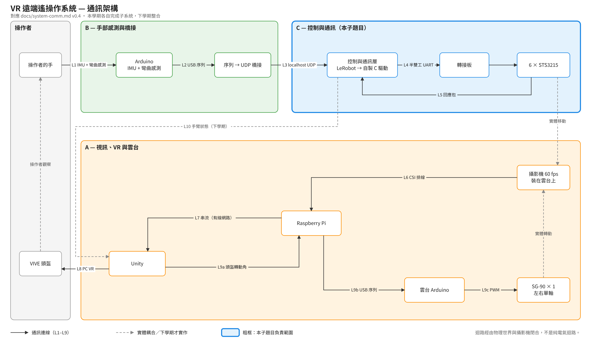
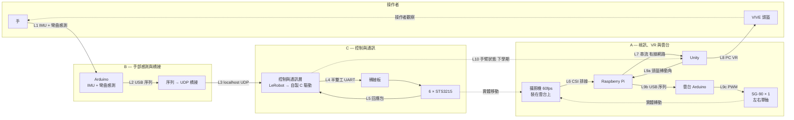
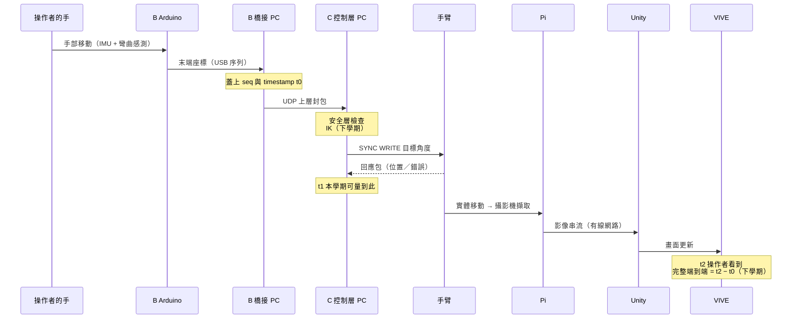

# 系統通訊架構

**版本**：v0.4
**日期**：2026/11/04
**範圍**：本學期各自完成子系統，下學期三人整合

VR 遠端遙操作機械手臂系統的元件、連線與介面定義。

**成員代號**
- **A** — 視訊、VR 與雲台
- **B** — 手部感測與橋接
- **C** — 控制與通訊層（本文件維護者）

**相關文件**
- [`interface-spec.md`](interface-spec.md) — L3 上層介面的封包規格（C 的交付物）
- [`open-questions.md`](open-questions.md) — 待確認事項，變動頻繁
- [`diagrams/system-comm.drawio.png`](diagrams/system-comm.drawio.png) — 方塊圖，可用 draw.io 直接編輯

---

## 1. 系統方塊圖

迴路經由物理世界與攝影機閉合，不是純電氣迴路。

---

## 2. 連線規格

### L1　操作者的手 → Arduino

| 項目 | 內容 |
|---|---|
| 感測方式 | IMU ＋ 彎曲感測 |
| 負責 | B |
| 備註 | 物理耦合，非通訊線 |

IMU 提供姿態、彎曲感測提供手指彎曲程度，兩者都不提供空間中的絕對位置。見 `open-questions.md` 問題 01。

### L2　Arduino → 橋接（USB 序列）

| 項目 | 內容 |
|---|---|
| 實體層 | USB-CDC |
| 負責 | B（兩端皆為 B 的程式） |
| 鮑率、格式、頻率 | 由 B 自行決定 |

兩端都在 B 手上，格式不需跨人協調。

### L3　橋接 → 控制層（localhost UDP）

| 項目 | 內容 |
|---|---|
| 負責 | B 實作橋接；**C 定義封包規格** |
| 傳輸 | UDP，`127.0.0.1:49200` |
| 封包格式 | 見 [`interface-spec.md`](interface-spec.md) |
| 頻率 | 目標 100 Hz，待 W10 實測確認 |
| Watchdog | 200 ms 無封包 → 保持當前位置，扭矩維持開啟 |
| 時間戳 | Unix epoch 牆鐘 µs，見 `interface-spec.md` §2.4 |

後端第一版用 LeRobot（團隊保底），第二版換自製 C 驅動，對 B 無感。

### L4 / L5　控制層 ↔ 手臂

| 項目 | 內容 |
|---|---|
| 實體層 | USB → 轉接板 → 半雙工 TTL UART，六顆菊鏈 |
| 協定 | STS3215 原廠協定 |
| 鮑率 | 待 W10 真機實測 |
| 型式 | request–response；SYNC WRITE 不回應 |
| 下行 | 目標角度、速度、扭矩開關 |
| 上行 | 目前位置、速度、負載、error byte |
| 失效行為 | 逾時重傳；超過次數 → 保持位置並回報上層 |

### L6　攝影機 → Raspberry Pi

| 項目 | 內容 |
|---|---|
| 介面 | CSI 排線 |
| 安裝位置 | 裝在雲台上，隨伺服馬達左右旋轉 |
| 幀率 | 60 fps |
| 解析度 | 待定 |

CSI 排線隨雲台反覆彎折有斷裂風險，見 `open-questions.md` 問題 03。

### L7　Raspberry Pi → Unity

| 項目 | 內容 |
|---|---|
| 實體層 | 有線網路 |
| 協定 | 未定 |
| 延遲 | 未量測。預期為視覺回饋鏈的主要延遲來源 |

### L8　Unity → VIVE 頭盔

PC VR（SteamVR / OpenXR）。非團隊自訂介面。

### L9　雲台控制

鏈路：`Unity（頭盔轉動角）→ L9a → Pi → L9b USB 序列 → 雲台 Arduino → L9c PWM → SG-90`

| 項目 | 內容 |
|---|---|
| 負責 | A，全鏈 |
| 指令來源 | 頭盔轉動角 |
| 伺服 | SG-90 × 1，左右單軸，PWM，無位置回授 |
| L9a | 傳輸方式未定 |
| L9b | USB 序列 |
| L9c | PWM |

單軸雲台對應三軸頭盔所帶來的視覺不一致，見 `open-questions.md` 問題 04。

與 C 無交集：SG-90 是 PWM 舵機，與 STS3215 匯流排伺服是不同的控制方式。

系統中兩種伺服並存，恰好形成對照：STS3215 有 12-bit 磁性編碼器可讀回實際角度，SG-90 開迴路、下了命令不知是否到位。這說明了手臂端為何需要位置回授與安全層。

### L10　控制層 → Unity（手臂狀態）

下學期的數位孿生用途。本學期不實作，僅在上層封包預留 `cmd_type 0x20`。

---

## 3. 一個控制週期的時序

端到端延遲必然包含機械響應與影像鏈，不只是通訊時間。

### 3.1 本學期可量測的範圍

| 區段 | 定義 | 本學期 |
|---|---|---|
| 控制迴路延遲 | `t1 − t0`：橋接蓋章 → 控制層 → 手臂 → 回應包回到控制層 | **可量，W12 交付** |
| 完整端到端延遲 | `t2 − t0`：加上實體運動、攝影機、串流、Unity、頭盔顯示 | 下學期 |

`t2` 需要 L10 手臂狀態回傳與影像鏈都接上，兩者都在下學期。**報告與 meeting 須明確說明 W12 量的是 `t1 − t0`**，不要讓人以為含視覺回饋。

這段仍是最有價值的數字——它直接對應文獻的週期模型（傳輸時間 + 馬達數 × 每顆回應延遲），也是 latency timer A/B 對照要比的對象。

### 3.2 量測方式

橋接端在上層封包蓋 `timestamp_us`，控制層在應用層取同一時基的時間相減。

**兩端必須同一個 epoch**：一律使用 Unix epoch 起算的牆鐘微秒。Python 端用 `time.time_ns() // 1000`，C 端用 `GetSystemTimePreciseAsFileTime()` 換算。完整規定與換算程式見 `interface-spec.md` §2.4。

**不使用 `QueryPerformanceCounter` 或 `perf_counter`**：它們的起點是開機或行程啟動後的任意時刻，跨行程相減得到的是兩個時鐘原點的差，不是延遲。

HAL 層不加微秒計時，避免三種 HAL 實作都要多一個函式（見 `lab-log/week07.md` C-15）。純粹在控制層內部量測的區段（例如單包 UART 往返）不跨行程，可用高解析度計時器。

---

## 4. 版本紀錄

| 版本 | 日期 | 變更 |
|---|---|---|
| v0.1 | 2026/11/04 | 初版，標出全部未決欄位 |
| v0.2 | 2026/11/04 | L1 感測方式、L3 橋接歸屬、L6 介面、L7 實體層、L9 雲台鏈確定 |
| v0.3 | 2026/11/04 | 攝影機確定裝於雲台；L9b 走 USB 序列；SG-90 一顆單軸 |
| v0.4 | 2026/11/04 | 修正 §3.2 量測方式：改為 Unix epoch 牆鐘時間，明列不可使用 QPC / `perf_counter` 的理由；新增 §3.1 區分本學期可量的 `t1 − t0` 與下學期的完整端到端；時序圖補上 `t1`；L3 補時間戳欄位；修正 L6 交互參照（問題 04 → 03）；L9 補問題 04 的參照 |
